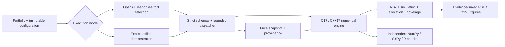
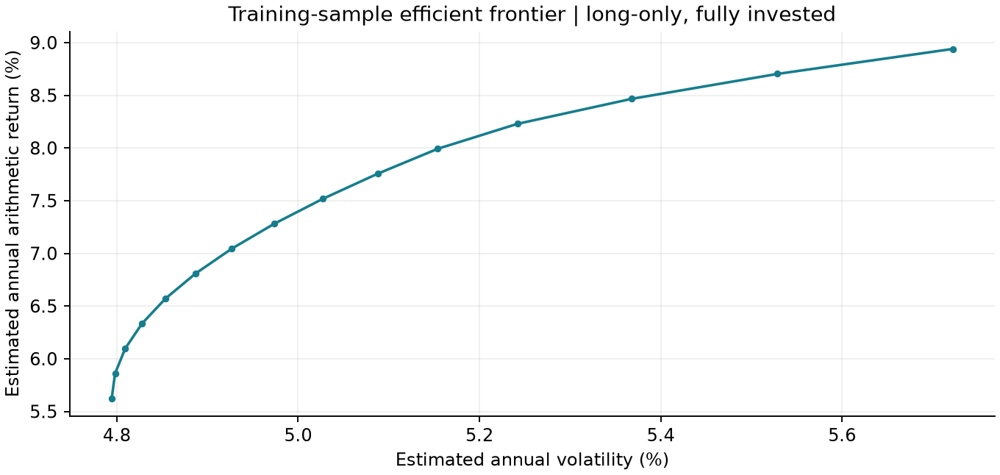

# Portfolio risk agent

**A C/C++ risk engine, explicit tool orchestration, and reports whose numbers can be checked.**

Given a portfolio and a fixed data request, the system retrieves prices, computes historical VaR and Expected Shortfall, simulates correlated return scenarios, fits a long-only mean-variance allocation, and evaluates it on later observations. The language model chooses analytical tools; native code performs every production financial calculation. Reports are rendered from saved numerical evidence, not numbers invented in model prose.

This is the second project in [quantitative-market-models](../../README.md). It has its own build, Python environment, fixtures, evaluation and outputs. The existing daily prediction study remains separate.

## Architecture



| Layer | Implementation | Responsibility |
|---|---|---|
| Numerical kernel | C17 and C++17 | CSV validation, return moments, linear algebra, empirical tails, simulation, constrained allocation, past-only VaR backtest |
| Agent and data boundary | Python | OpenAI Responses loop, JSON schemas, fixed-configuration enforcement, Yahoo adapter and artifact IDs |
| Independent checks | Python / NumPy / SciPy and base R | Separate numerical implementations, solver comparison, analytical simulation checks and failure cases |
| Reporting | Python | Tables, charts and a three-page PDF from persisted native results |
| Automation | CMake / CTest and GitHub Actions | Native builds, tests, sanitizers, end-to-end demonstration and R reference check |

The C engine owns its seeded random stream; the C++ engine has no external numerical-library dependency. The exact small-universe optimiser enumerates active supports, rather than delegating production optimisation to SciPy. The supported universe is **1-8 assets**: this is an inspectable research implementation, not a large-universe trading platform.

## Start with the reproducible demonstration

Requirements: CMake 3.16+, a C17/C++17 compiler, and Python 3.12 for the pinned environment. Run from this directory:

```bash
python3.12 -m venv .venv
source .venv/bin/activate
python -m pip install -r requirements-lock.txt
cmake -S . -B build -DCMAKE_BUILD_TYPE=Release
cmake --build build --parallel 2
ctest --test-dir build --output-on-failure
python -m pytest -q
python agent.py --mode demo
```

The default uses `configs/demo.json` and a **fully synthetic**, versioned 900-row, three-asset price fixture. It creates a new `runs/` directory and reports its location. An existing run is never silently overwritten. Demo mode executes a visible six-tool workflow and makes **no LLM or market-data network calls**. It is a numerical and orchestration demonstration, not a measurement of LLM reasoning or live trading performance.

Inspect the [archived demo report](outputs/demo/portfolio_report.md), [PDF](outputs/demo/portfolio_report.pdf), [allocation](outputs/demo/portfolio_allocation.csv), [run manifest](outputs/demo/run_manifest.json), and [independent evaluation](outputs/evaluation/evaluation_report.md).



*Training estimates from synthetic data. The allocation is fitted before the holdout begins; realised holdout risk and return are reported separately.*

## Use an actual LLM

Set `OPENAI_API_KEY` in your local environment and select an API model you can access. OpenAI API keys are never accepted as tool arguments or recorded in run artifacts. Yahoo provider caches stay in ignored local runs.

```bash
python agent.py --mode openai --model YOUR_MODEL_ID \
  --config configs/demo.json \
  --request "Analyse my portfolio, estimate 99% VaR and propose a lower-risk allocation."
```

This invokes the [OpenAI Responses function-calling API](https://developers.openai.com/api/docs/guides/function-calling). Strict tool schemas are validated again locally. The loop preserves tool-call IDs and reasoning items, limits calls and rounds, returns structured failures, and requires a successful evidence report before accepting a final response. Model-generated commentary is saved separately from the authoritative numerical report.

**Validation status:** the checked-in demonstration is scripted. Mock-client tests exercise the real loop's API contract and error handling; live model tool-selection accuracy requires a separate API run and is not claimed by those tests. Use the [evaluation cases](evaluation/test_cases.json) and retain the actual model/response IDs and run logs when evaluating live behavior.

The optional live evaluator scores the public full-analysis contract separately from task completion and does not grade unsupported claims in free text:

```bash
python evaluation/live_agent.py --model YOUR_MODEL_ID --output-dir runs/live-evaluation
```

Partial-risk and refusal prompts in the public case file are design/contract cases, not currently scored live cases. No held-out model-accuracy claim is made.

## Retrieve market data

Copy `configs/demo.json` to a new config, set `source` to `yahoo`, choose real same-currency tickers, dates and portfolio weights, and retain enough observations for the training/holdout and rolling-window settings. Both modes can use this adapter; `--mode demo` with a Yahoo config is a scripted workflow with a **real network data request**.

The [yfinance adapter](https://ranaroussi.github.io/yfinance/reference/api/yfinance.download.html) requests daily adjusted closes with explicit settings. It retains the snapshot, request, retrieval time, dependency versions and hashes. It rejects missing, nonpositive, nonfinite or duplicate observations rather than forward-filling them. All requested assets must be present. Exchange-calendar completeness, currencies and provider corrections still require judgement. Yahoo downloads are excluded from version control; [provider terms apply](https://ranaroussi.github.io/yfinance/).

## Read the result correctly

- **Historical risk:** one-observation signed loss VaR with type-7 interpolation; ES integrates the empirical worst-tail mass, including fractional boundaries. They are two explicitly documented sample estimators.
- **Monte Carlo:** correlated Gaussian log returns, fitted sample moments, a stated covariance ridge, seeded paths and daily rebalancing. Horizon is in observations, not calendar days.
- **Allocation:** long-only, fully invested minimum variance and efficient-frontier solutions; fit on the first 504 returns by default. Holdout weights are fixed from that fit. Mean estimates are uncertain and costs are omitted from this allocation illustration.
- **Coverage:** rolling one-observation historical VaR uses only earlier returns. Kupiec coverage handles zero and all breaches; its asymptotic p-value does not test independence.
- **Lower risk:** the optimiser minimises estimated variance. Tail losses, concentration and future risk need not improve. A synthetic result cannot establish market performance.

See [validation status](docs/validation_status.md), [numerical conventions](docs/numerical_methods.md), [execution and evidence contract](docs/execution_contract.md), and [data provenance](data/README.md).

## Independent evaluation

```bash
python evaluation/evaluate.py --engine build/qfa_engine --output-dir runs/evaluation
# Base R provides another independent check; see evaluation/README.md.
make sanitizers
```

The evaluator compares the native engine with independent calculations, checks training/holdout separation, compares frontier constraints and objectives, evaluates Monte Carlo against an analytical reference, and records errors and tolerances. Separate tests exercise malformed data, unavailable providers, invalid tools, invalid parameters, call budgets and failure recovery. Neither a successful tool call nor a plausible report is evidence of numerical correctness by itself.

## Layout

```text
native/                 C/C++ library, command-line engine and CTest cases
python/qfa/             schemas, agent loop, data boundary, dispatcher and report
configs/                explicit portfolio and calculation settings
data/                   synthetic fixture, generator and provenance
evaluation/            independent Python/R checks and tool-selection cases
outputs/                archived synthetic demonstration and evaluation
runs/                   local runs, ignored by Git
```

The numerical methods are established methods, not claimed innovations. The contribution is their inspectable native implementation, bounded tool interface, independent validation and traceable research workflow. No brokerage connection or order execution is included.
