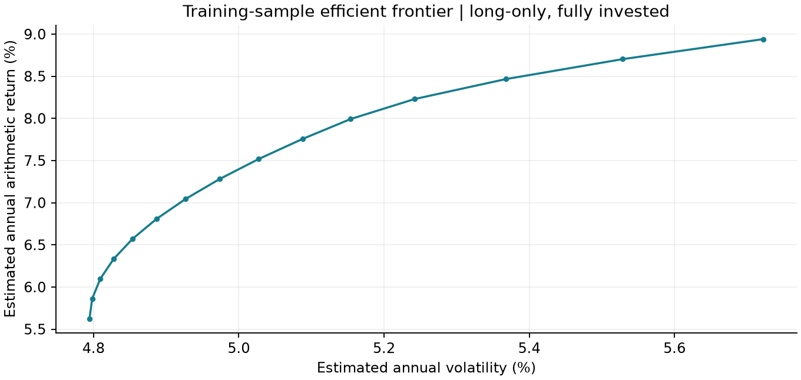
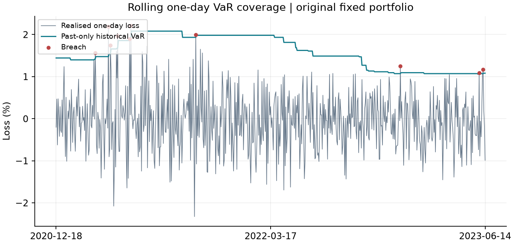

# Portfolio risk evidence report

**SYNTHETIC FIXTURE** | Scripted offline workflow; no LLM called

Confidence: 99.0%. Historical horizon: one recorded observation. Portfolio value 1,000,000 is illustrative monetary scaling, not actual account holdings.

Historical VaR: 1.61%; ES: 1.95%. Monte Carlo (1 observations, 20,000 paths): VaR 1.54%; ES 1.76%.

## Allocation and validation

The candidate minimises estimated training-sample variance under long-only, fully invested constraints. Holdout annual volatility is 4.48%, compared with 9.72% for the original portfolio. This objective does not minimise every tail-risk metric or guarantee future risk reduction.

| Asset | Original | Candidate |
|---|---:|---:|
| SYNTH_EQUITY | 60.00% | 9.70% |
| SYNTH_DEFENSIVE | 25.00% | 17.32% |
| SYNTH_BOND | 15.00% | 72.98% |

Optimisation uses only the first 504 return observations. Holdout metrics use subsequent observations with weights fixed from training, daily rebalancing and no turnover costs. Full-sample risk estimates are descriptive and are not part of allocation fitting.

Rolling original-portfolio VaR: 10/649 breaches (1.54%); Kupiec asymptotic p=0.1996. Thresholds use strictly earlier returns. Coverage alone does not establish independent breaches. The optimised candidate's holdout tail statistics are not a separate rolling VaR coverage test.

## Evidence and limits

Numerical evidence: estimate_risk.json, simulate_risk.json, optimise_portfolio.json and backtest_var.json. Data snapshots and provenance: data/. Configuration and hashes: input_config.json and run_manifest.json. Tool outcomes: tool_audit.json and agent_run.json. Model commentary, if any, is not the source of report numbers.

Historical quantiles use linear interpolation; ES is the upper-tail empirical loss integral with fractional boundary mass. Monte Carlo assumes correlated Gaussian log returns, stationary fitted moments and daily rebalancing; fat tails and regime shifts can invalidate it. The efficient frontier uses a regularised covariance and noisy historical mean returns. No trade is placed. Synthetic results test implementation, not market performance. Live market data require aligned calendars, currencies and verified adjustments.

## Conditional holdout uncertainty

Paired moving-block bootstrap, 1,000 resamples, seed 42. Improvements are original minus candidate, so positive values favour the candidate. Weights remain fixed from training; these intervals do not include refitting, model-selection or future-regime uncertainty. Tail differences below are percentage points.

| Metric | Block length | Improvement | 95% interval |
|---|---:|---:|---:|
| VAR | 10 | 0.50% | [0.37%, 0.61%] |
| ES | 10 | 0.38% | [0.09%, 0.61%] |
| VAR | 20 | 0.50% | [0.39%, 0.61%] |
| ES | 20 | 0.38% | [0.19%, 0.63%] |

See holdout_uncertainty.csv for all metrics including annualized variance. Native variance contributions are in optimise_portfolio.json; signed contributions can reflect hedging.
